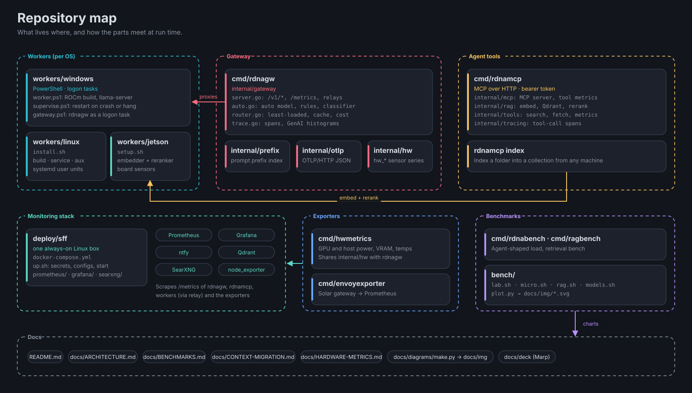
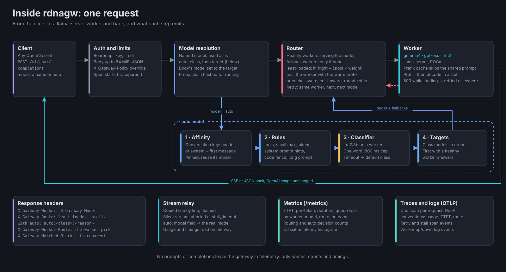
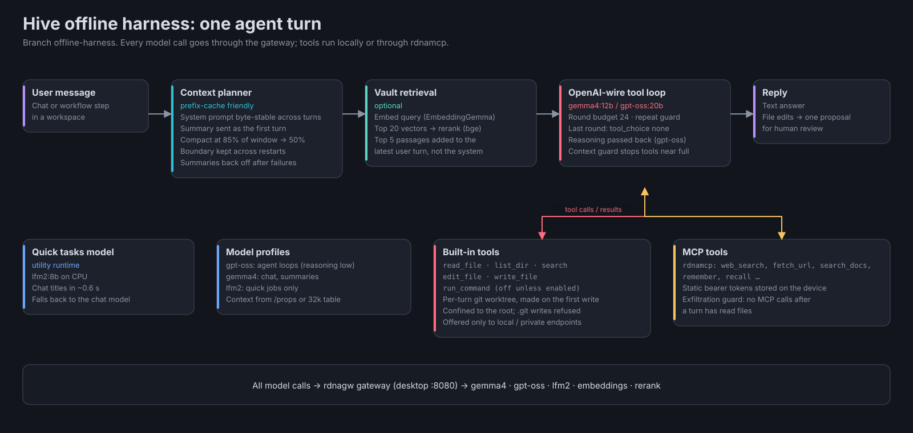

# Lab architecture

Diagrams are generated by `python3 docs/diagrams/make.py`; edit the layouts there when the lab changes.

## Repository map

- **Workers** (`workers/`) are per-OS scripts that install a ROCm build of llama.cpp and run
  `llama-server` as a service: logon tasks plus a supervisor on Windows, systemd user units on
  Linux, and the embedder and reranker on the Jetson.
- **The gateway** (`cmd/rdnagw`, `internal/gateway`) is the one endpoint clients call. It
  leans on `internal/prefix` (which worker holds which prompt prefix), `internal/otlp`
  (dependency-free OTLP/HTTP JSON export) and `internal/hw` (sensor readings as `hw_*`
  series, shared with `cmd/hwmetrics`).
- **Agent tools** (`cmd/rdnamcp`, `internal/{mcp,rag,tools,tracing}`) serve MCP over HTTP and
  call the Jetson's embedder and reranker directly.
- **The monitoring stack** (`deploy/sff`) runs Prometheus, Grafana, ntfy, Qdrant and SearXNG
  under Docker Compose on the server box and scrapes everything else.
- **Benchmarks** (`cmd/rdnabench`, `cmd/ragbench`, `bench/`) drive the gateway and workers and
  draw the charts in `docs/img`.

## Inside the gateway

One request passes through these steps (`internal/gateway/server.go` unless noted):

1. **Auth and limits.** The bearer key is checked when `api_key` is set, the body is capped
   at 64 MiB and parsed, and the request's span starts, parented on the caller's `traceparent`.
2. **Model resolution.** A named model is used as is. For `auto` (`auto.go`): a conversation
   already pinned to a model keeps it; otherwise cheap rules (tools, a small `max_tokens`,
   system prompt hints, a code block, a long prompt) pick a class, and only when none fits
   does the classifier model, served by the gateway's own workers under an 800 ms cap, name
   one. The class's first model with a healthy worker becomes the target, and the body's
   `model` field is rewritten to it.
3. **Routing** (`router.go`). Among healthy workers that serve the model (fallback workers only
   when no primary one is up), the default `least-loaded` policy takes the lowest in-flight ÷
   (slots × weight), and among ties the worker already holding the prompt's prefix.
   A dropped keep-alive is retried on the same worker; a worker that refuses the connection
   (marked down until its next health check) or answers 503 while loading passes the request
   to the next one; for `auto`, the next model after that.
4. **Worker.** llama-server reuses its prefix cache, prefills the rest and decodes in a slot.
5. **Back to the client.** The response streams back line by line, unchanged except that
   `auto` responses name the model that answered. Headers say where it went
   (`X-Gateway-Worker`, `X-Gateway-Route`, `X-Gateway-Model`). Usage and llama-server timings
   are read on the way past and feed the latency histograms at `/metrics`, the routing
   counters, the learned per-worker speeds, and the request's span.

## Topology

Service traffic between the boxes, and from the MacBook and phone wherever they are, rides
Tailscale. Only the Enphase IQ Gateway is LAN-only; the server box reads it over the LAN.

## Services

- **Models:** one OpenAI-compatible endpoint, `rdnagw` on the desktop (`:8080`), routes by model
  name (or, for the model `auto`, picks one per request) to llama.cpp workers: gemma4 12B on the RX 6900 XT, gpt-oss 20B and the CPU's lfm2 on
  the server box, and the embedder and reranker on the Jetson.
- **Tools:** `rdnamcp` on the server box (`:8090`, MCP over HTTP with a bearer token) offers web
  search (SearXNG), page fetch (public addresses only), document search and long-term memory
  (Qdrant with the Jetson's embedder and reranker).
- **Monitoring:** Prometheus on the server box scrapes everything, including the desktop worker
  and LibreHardwareMonitor through the gateway's relays, both node_exporters and the Enphase
  exporter. Each host's power and GPU readings arrive as the same `hw_*` series
  ([HARDWARE-METRICS.md](HARDWARE-METRICS.md)). Grafana shows the dashboard and sends alerts
  to ntfy.
- **Traces (optional):** with `otlp` set in `gateway.json`, the gateway sends a span per
  request (OTLP/HTTP JSON, GenAI semantic conventions) to any OTLP collector, and passes W3C
  trace context on to the workers.
- **Tool traces (optional):** with `OTEL_EXPORTER_OTLP_ENDPOINT` set, `rdnamcp` sends OTLP/HTTP
  (JSON) traces to any OpenTelemetry receiver: one server span per MCP request
  (`mcp.method.name`, `gen_ai.tool.name`, `mcp.session.id`, `jsonrpc.request.id`, `error.type`),
  a child of the agent's own span when the request carries a `traceparent`, with client spans
  below it for the embedder (`gen_ai.operation.name=embeddings`), the reranker and Qdrant
  (`db.system.name=qdrant`). They carry counts and timings, not content.

## Hive's offline harness

What one agent turn does on the `offline-harness` branch of Hive: a cache-friendly context
plan, optional vault retrieval, the OpenAI-wire tool loop with built-in and MCP tools, and the
quick-tasks model for titles.
