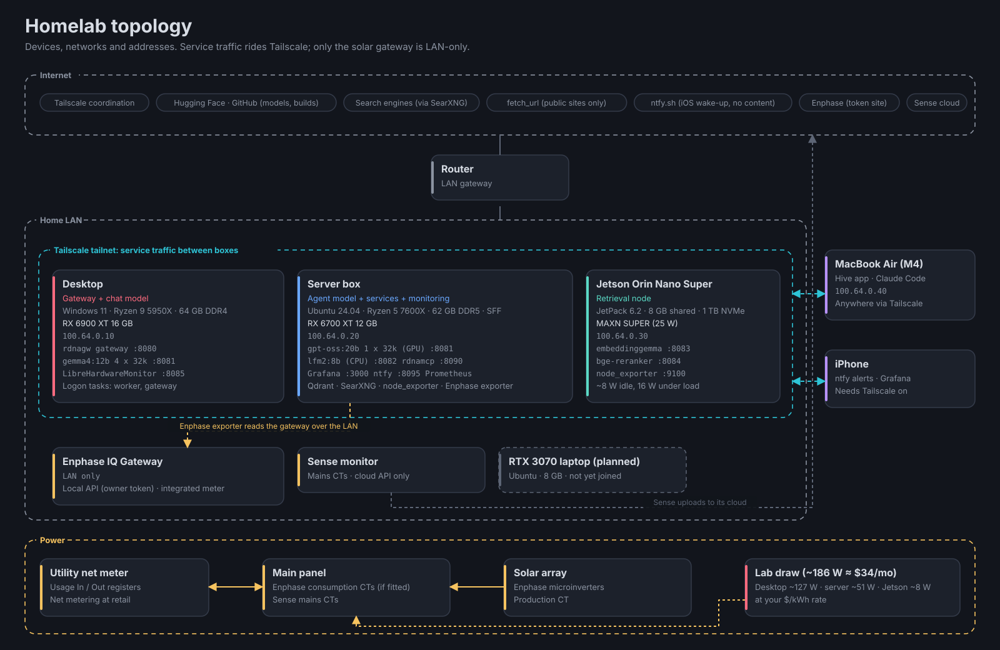
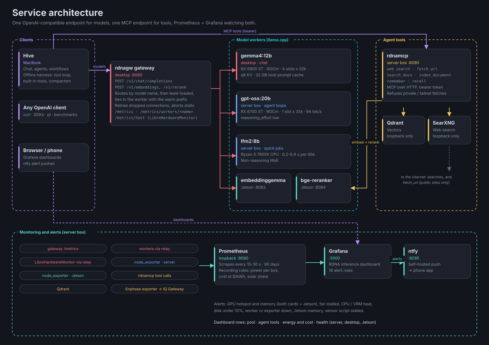
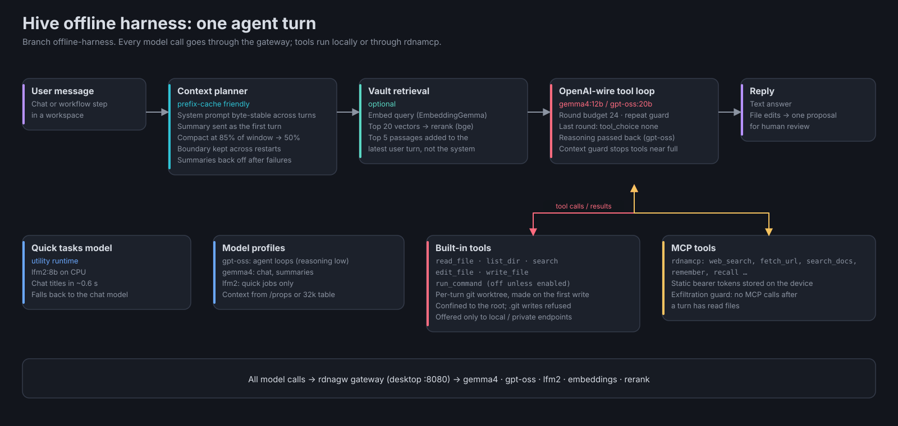

# Lab architecture

Diagrams are generated by `python3 docs/diagrams/make.py`; edit the layouts there when the lab changes.

## Topology

Service traffic between the boxes, and from the MacBook and phone wherever they are, rides
Tailscale. Only the Enphase IQ Gateway is LAN-only; the server box reads it over the LAN.

## Services

- **Models:** one OpenAI-compatible endpoint, `rdnagw` on the desktop (`:8080`), routes by model
  name to llama.cpp workers: gemma4 12B on the RX 6900 XT, gpt-oss 20B and the CPU's lfm2 on
  the server box, and the embedder and reranker on the Jetson.
- **Tools:** `rdnamcp` on the server box (`:8090`, MCP over HTTP with a bearer token) offers web
  search (SearXNG), page fetch (public addresses only), document search and long-term memory
  (Qdrant with the Jetson's embedder and reranker).
- **Monitoring:** Prometheus on the server box scrapes everything, including the desktop worker
  and LibreHardwareMonitor through the gateway's relays, both node_exporters and the Enphase
  exporter. Grafana shows the dashboard and sends alerts to ntfy.

## Hive's offline harness

What one agent turn does on the `offline-harness` branch of Hive: a cache-friendly context
plan, optional vault retrieval, the OpenAI-wire tool loop with built-in and MCP tools, and the
quick-tasks model for titles.
