# Benchmarks

All numbers come from this repo's harness: `bench/lab.sh` drives the workers and
`bench/plot.py` renders `bench/results/*.jsonl` into the graphs below and into
[`bench/results/tables.md`](../bench/results/tables.md), which has every table in full.

## Lab

| | RX 6900 XT | RX 6700 XT | MacBook Air |
|---|---|---|---|
| arch | RDNA2, gfx1030, 16 GB, 512 GB/s | RDNA2, gfx1031, 12 GB, 384 GB/s | Apple M4, 24 GB unified, 120 GB/s |
| host | Windows 11, Ryzen 9 5950X, 64 GB | Ubuntu 24.04, Ryzen 7000 (Raphael), 62 GB | macOS, fanless |
| build | llama.cpp ROCm gfx103X ([lemonade-sdk b1348](https://github.com/lemonade-sdk/llamacpp-rocm)); official Vulkan b11719 | llama.cpp ROCm gfx103X (lemonade-sdk b1349) | official ggml-org Metal b11719 |

- **Models:** gemma4 12B QAT Q4_0 (dense, Google's GGUF); LFM2.5 8B-A1B Q4_K_M; gpt-oss 20B MXFP4; Qwen3.6 35B-A3B UD-Q4_K_M. All are verified by sha256.
- **Agent workload:** each agent has a long system prompt, then loops through reply → tool result (2–4 KB) → reply. Replies are a fixed 128 tokens (`ignore_eos`). Unless noted, workers run with flash attention, q8_0 KV, `--cache-reuse 256`, and the default 8 GB host prompt cache.
- **Caveats:** the 6900 XT box is someone's everyday desktop, so other processes share it and runs vary. The long routing scenario was repeated 4×, and its error bars show the spread. The fanless Air throttles under sustained load.

## Kernels (llama-bench)

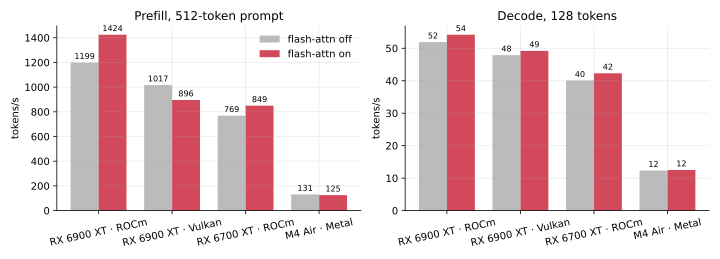
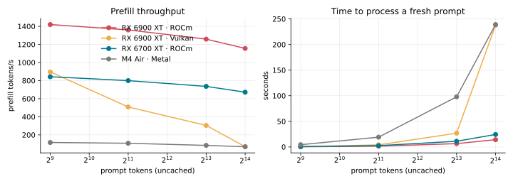
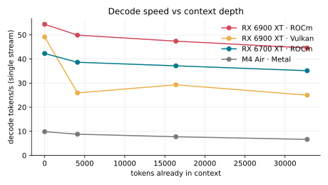
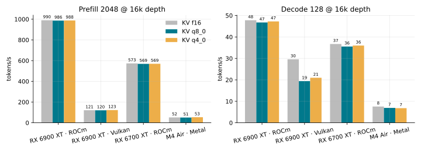

- **ROCm is the RDNA2 backend.** Vulkan's prefill collapses with prompt length: 69 tok/s at 16k tokens, so a fresh 16k prompt takes 238 s, versus 14 s on ROCm. Its decode also halves past 4k tokens of context.
- **Flash attention:** +19% prefill on ROCm. It hurts on Vulkan.
- **KV cache type costs no speed** on ROCm (f16, q8_0 and q4_0 are within 1%), so the trade is purely VRAM against quality.
- **Ollama's GGUF of the same model decodes at half speed** (28 vs 54 tok/s) and prefills at about a sixth the speed of llama.cpp ROCm on the same card. Use the upstream GGUF.

## Serving one card

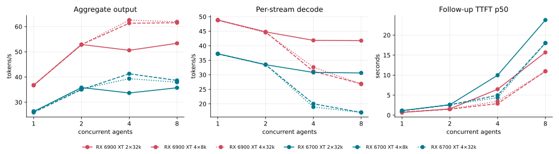
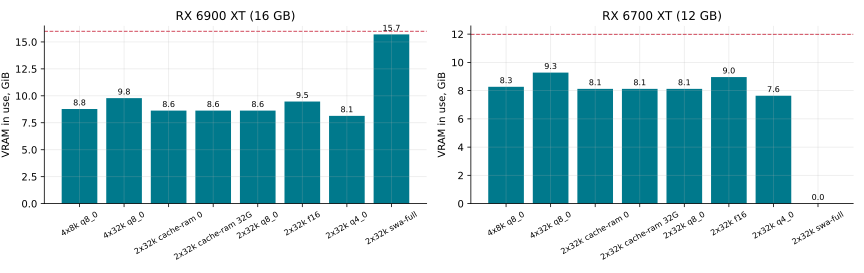

- **Use 4 slots × 32k context.** It gives the best aggregate (62 tok/s on the 6900 XT vs 53 with 2×32k), and SWA keeps it under 10 GB of VRAM on both cards.
- **More slots trade per-stream speed for total throughput.** Beyond the slot count, extra agents only queue.

## Caching

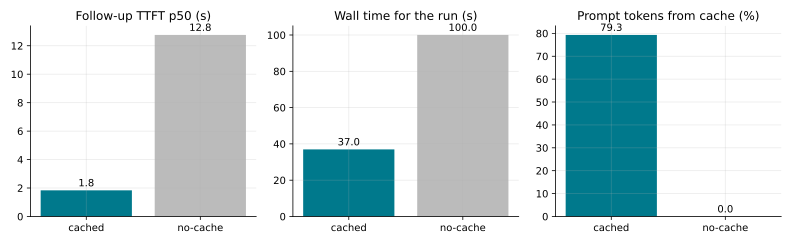
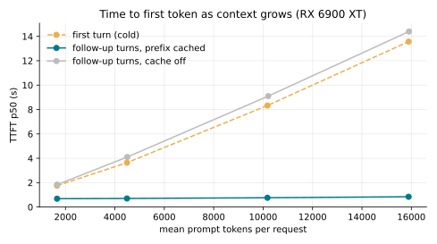
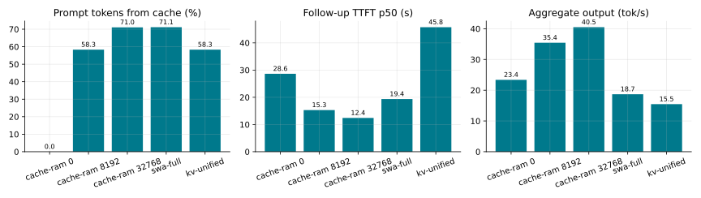

- **Prefix caching is a 2.7× wall-time win** on agent traffic (37 s vs 100 s). A cached follow-up turn at a 16k-token context starts in 0.8 s; uncached it takes 14 s.
- **Host-RAM prompt cache** (`--cache-ram`). With 6 agents on 2 slots, evicted conversations are restored from RAM instead of re-processed:

  | `--cache-ram` | time | vs off |
  |---|---:|---:|
  | 0 (off) | 131 s | – |
  | 8 GB (default) | 87 s | −34% |
  | 32 GB | 76 s | −42% |

  Give it the spare RAM.
- **Leave `--swa-full` and `--kv-unified` off.** On the 6900 XT they cost 1.9× and 2.3× the time. `--swa-full` doesn't even fit 2×32k on the 12 GB card.

## Compaction

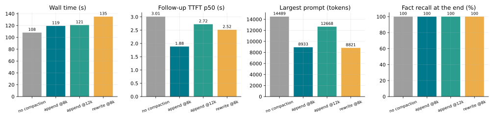

- **Put the summary after the system prompt, never in it.** Rewriting the system prompt invalidates the whole cache: the next turn was 0% cached and took 5.6 s to the first token, against 75% cached and 1.8 s.
- **Summaries are expensive.** Each costs 20–34 s of generation (512 tokens), so compaction pays off only once history would otherwise exceed the slot, or prefill would cost more than that. At about 16k tokens, never compacting was fastest.
- **Recall survived compaction** for gemma4, gpt-oss and Qwen3.6 (100%, including the compacted-away facts). The smallest model, LFM2.5 (1B active), kept only half of them.
- **Give reasoning models an answer budget.** At 160 answer tokens, gpt-oss and LFM2.5 "failed" probes by running out of tokens mid-reasoning (67% and 75%). At 1024 they score 100% and 95%. The quality runs use 1024.

## Routing across two cards

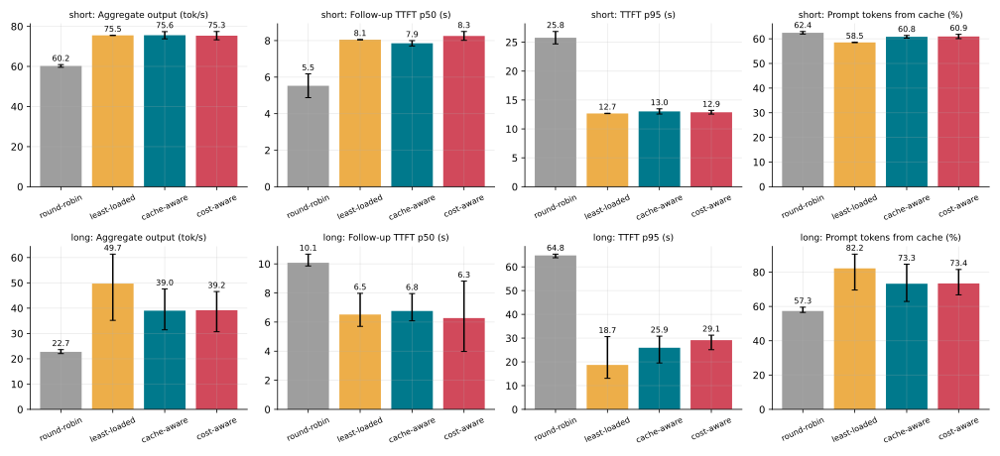

- **Anything beats round-robin.** It's 25% slower on short contexts and 2× slower on long ones, because it ignores that the cards differ.
- **With long contexts, least-loaded won** (50 vs 39 tok/s aggregate, with *higher* cache reuse, 82% vs 73%). Prefix affinity piles conversations onto a warm card past its 2 slots. That forces evictions to the host cache, which least-loaded's spreading avoids. Cache-aware and cost-aware tied.
- **Deployment default: `least-loaded`** (6700 XT `weight` 0.65, its measured prefill/decode ratio). The deployed pair (4×32k each, 32 GB host cache) ran 8 agents at **83 tok/s aggregate**, 0 failures. The next router change should count *resident sessions per slot*, not just in-flight requests, so affinity stops once a card's slots are spoken for.

## Dense vs MoE

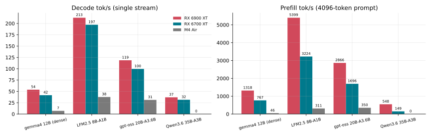
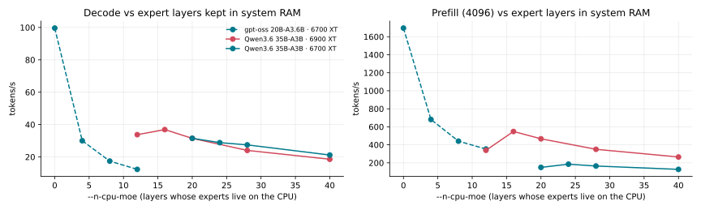

| model (RX 6900 XT) | pp4096 | tg128 | needle | recall after compaction |
|---|---:|---:|---|---|
| gemma4 12B dense | 1318 | 54 | 20/20 | 100% |
| LFM2.5 8B-A1B | 5399 | 213 | 19/20 | 67% |
| gpt-oss 20B-A3.6B | 2866 | 119 | 20/20 | 100% |
| Qwen3.6 35B-A3B (16 expert layers on CPU) | 548 | 37 | 20/20 | 100% |

- **Small MoE models are the RDNA2 sweet spot.** gpt-oss is 2.2× gemma4's prefill and decode, needle-perfect to 28k tokens, and keeps facts through compaction. LFM2.5 is 4× faster still, but it's the one that forgets compacted facts.
- **A 35B MoE runs on a 16 GB card** when its experts are split with `--n-cpu-moe`. 16 layers is the optimum on the 6900 XT: fewer overflows VRAM, more starves on DDR4.

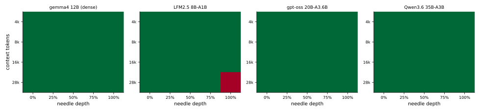
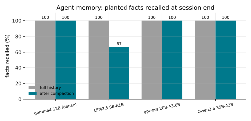

## The MacBook

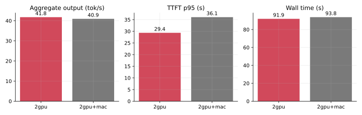

- **As a pool member the Mac adds nothing.** The cost-aware router sent it 0 of 30 requests, because it's 11× slower on prefill and 4–8× slower on decode, and throttles.
- **As `fallback: true` it's useful:** when both GPU boxes went down, it served everything, slowly, with no failures.

## Agent tools on the server box

`deploy/sff` adds monitoring, a CPU model for quick jobs, retrieval and web search to the
6700 XT box, and serves them to agents over MCP (`rdnamcp`). Retrieval was measured on
llama.cpp's own docs: 119 Markdown files, 1,732 passages of up to 1,200 characters. gemma4
wrote 150 questions from randomly sampled passages; a question counts as found only when
its source passage comes back.

### Quick jobs on the CPU

| model (Ryzen 5 7600X, 5 threads) | decode | title / classify / route job |
|---|---:|---:|
| LFM2 8B-A1B | 52 tok/s | **0.2–0.4 s**, all correct |
| LFM2.5 8B-A1B | 47 tok/s | about 6 s: it always reasons first (~280 tokens), and thinking can't be turned off |

### Retrieval quality

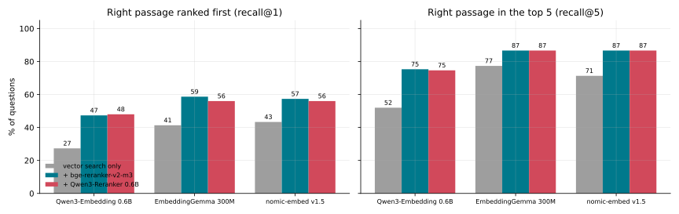

- **Rerank.** A cross-encoder over the top vector hits adds 15 points of recall@1 and 10 of
  recall@5 for every embedder. The two rerankers tie on quality; bge-reranker-v2-m3 is
  about 25% faster.
- **The smallest embedder won.** EmbeddingGemma 300M beat Qwen3-Embedding 0.6B by 25 points
  of recall@5 (77% vs 52% before reranking), at a fifth of the indexing time. nomic-embed
  v1.5 was close behind it. llama.cpp already appends Qwen3's end-of-text token, so that
  isn't the cause.
- **Rerank the top 20.** Rescoring 20 candidates found 85% of answers in the top 5 vs 87% for
  30, at two-thirds of the cost. That's the deployed default (`RERANK_CANDIDATES`).
- Caveat: gemma4 wrote the questions, which may favour EmbeddingGemma slightly; nomic,
  which has no family tie, lands within 1–2 points of it after reranking.

### CPU vs GPU for embeddings and reranking

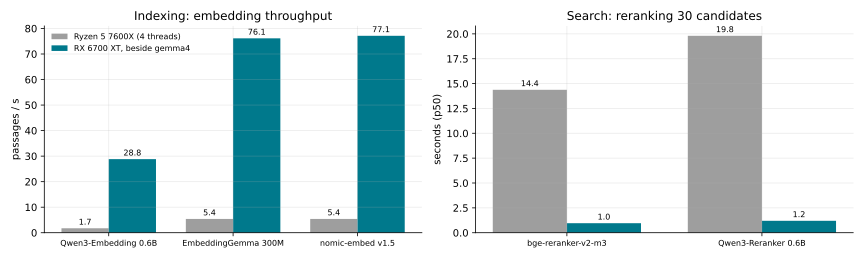

The 6700 XT (beside the resident gemma4 worker) embeds 15–17× faster and reranks 15× faster
than the CPU. On the CPU a reranked search takes 14–20 s, so retrieval runs on the GPU as
two small systemd units (`workers/linux/install.sh aux`), which together leave 1.5 GB of
VRAM free.

### Retrieval vs. long context

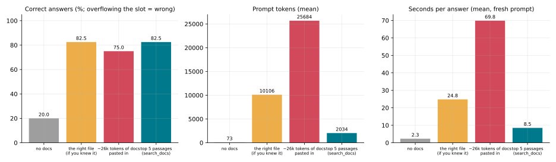

40 questions, answered by gemma4 12B with fresh prompts and graded by gemma4 against the
reference answer:

| what the model got | correct | prompt tokens | seconds per answer |
|---|---:|---:|---:|
| no docs | 20% | 73 | 2.3 |
| the right file (if you knew it) | 82.5% (2 overflowed the slot) | 10,100 | 24.8 |
| ~26k tokens of docs, including the right file | 75% (9 overflowed) | 25,700 | 69.8 |
| **top 5 passages from `search_docs`** | **82.5%** | **2,000** | **8.5** |

- **Retrieval matched handing the model the right file without knowing which file it was,**
  with a fifth of the tokens, in a third of the time, and 8× faster than pasting docs in.
- **Long context is accurate when it fits** (97% of the prompts that fit were answered
  correctly), but these docs tokenize at about 2.4 characters per token, so 9 of 40 pasted
  contexts overflowed a 32k slot and 2 single files were bigger than a slot.

### Web search

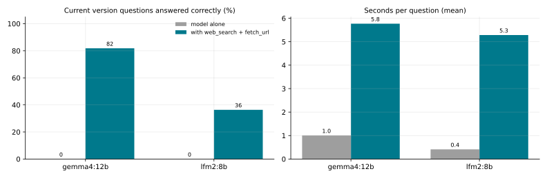

Eleven "what is the latest version of X" questions, checked against answers fetched live from
go.dev, GitHub releases and endoflife.date. Without tools neither model got any right; gemma4
mostly declined, while lfm2 confidently gave old versions.

- **gemma4 with `web_search` + `fetch_url`: 9/11 in 5.8 s per question.** Its misses were a
  partial answer ("Go 1.27" for 1.27.2) and an older llama.cpp release.
- **lfm2: 4/11.** It often searches and still invents a version, so keep it to titles and
  classification.

### Contention

| background load (continuous) | gemma4 on the 6700 XT, 4 agents | lfm2 title job |
|---|---:|---:|
| none | 39.6 / 49.7 tok/s (two runs) | 0.23 s |
| CPU indexing | 46.5 / 46.3 tok/s | 0.28 s |
| GPU reranking | **24.9 tok/s** | 0.22 s |

CPU work doesn't touch the GPU worker. Reranking without pause on the same GPU halves its
throughput. A real search is a burst of about 1 s of GPU time, so occasional searches cost
little, but steady heavy search traffic would justify a separate card for the reranker.

### Hardware health

The dashboard tracks the 6700 XT's edge, junction and memory temperatures, power against its
cap, fan duty, and the CPU, VRM, board, RAM and NVMe temperatures. Under the benchmark load
the card ran at 81 °C junction, 72 °C memory, and 123 W of its 186 W cap. Grafana alerts
(pushed through a self-hosted ntfy) fire at 95 °C junction for 10 minutes (103 °C for 2
minutes is critical; the card throttles at 110 °C), at 92 / 100 °C for GDDR6 (rated to 105),
on a stalled fan under load, CPU above 90 °C, VRM above 100 °C, a disk under 10% free, and a
worker or exporter down for 5 minutes.

The desktop's 6900 XT and 5950X get the same treatment through LibreHardwareMonitor, whose
sensors the gateway relays at `/metrics/host`: hotspot alerts at 95 / 103 °C, a stalled fan
under load (its zero-RPM idle mode doesn't count), and the CPU above 85 °C.

## Jetson Orin Nano Super as the retrieval node

The 8 GB Orin (JetPack 6.2, MAXN SUPER, models on NVMe) now runs the embedder and reranker,
so the 6700 XT's whole 12 GB can hold gpt-oss 20B. Same corpus and settings as above:

| | Jetson Orin Nano Super | RX 6700 XT (beside gemma4) | Ryzen 5 7600X CPU |
|---|---:|---:|---:|
| embed (EmbeddingGemma), passages/s | 24.7 | 76 | 5.4 |
| embed a query | 22 ms | 9 ms | 30 ms |
| rerank 30 passages (bge-reranker-v2-m3) | 3.3 s | 1.0 s | 14.4 s |
| search_docs end to end (20 candidates) | ~4.5 s | ~2 s | 10 s+ |
| LFM2 8B-A1B title job | 0.30 s | – | 0.2–0.4 s |
| LFM2 prefill / decode, tok/s | 948 / 42 | – | ~174 / 52 |
| power under load / peak junction | 16 W avg, 23 W max / 72 °C | 120–186 W | – |

Reranking is compute-bound on the Orin (more parallel slots didn't help); rerank 10 candidates
instead of 20 for ~2.3 s at 81% vs 85% recall@5. Memory is the limit: embedder + reranker use
~2.5 GB of the shared 7.4 GB, LFM2 alone ~5.9 GB, so not all three at once.

With retrieval off it, the 6700 XT runs gpt-oss 20B (MXFP4): **94 tok/s fully on the GPU with
one 32k slot**; two 32k slots don't fit and need one layer's experts on the CPU (59 tok/s each)
or two (44 tok/s). Tool calls work through the gateway with `reasoning_effort: low`.
