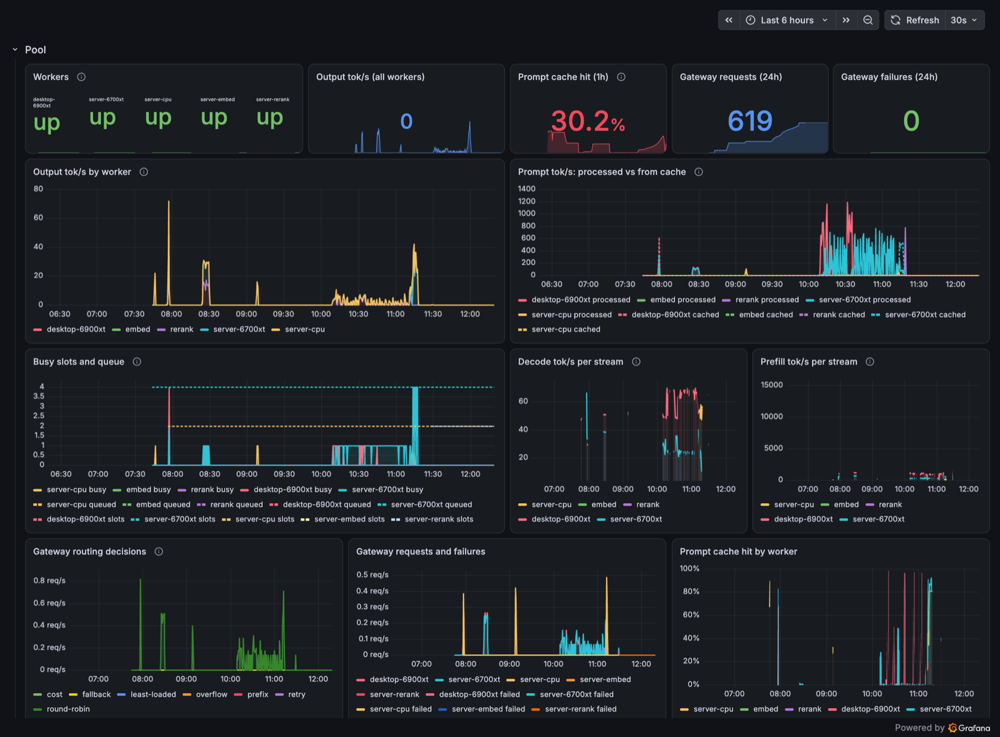
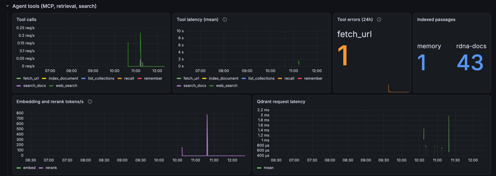
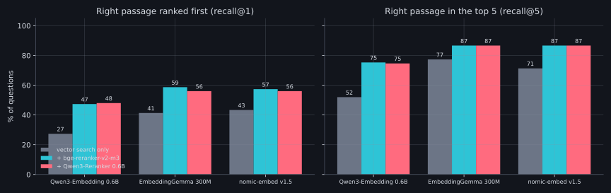
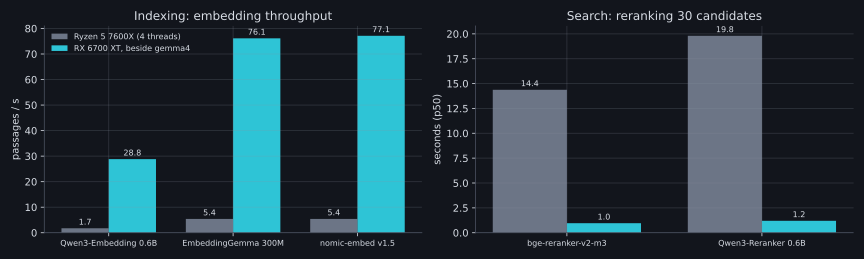
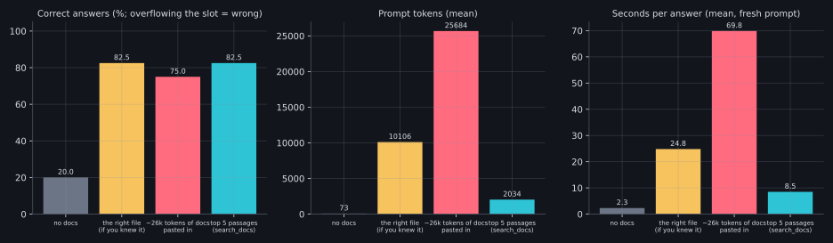
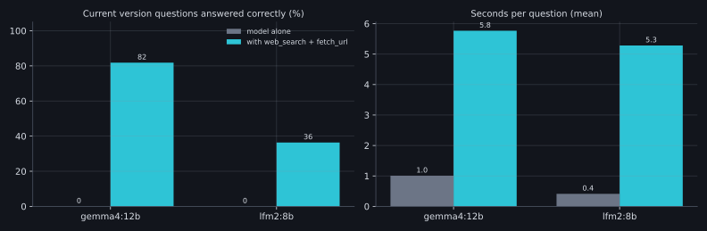
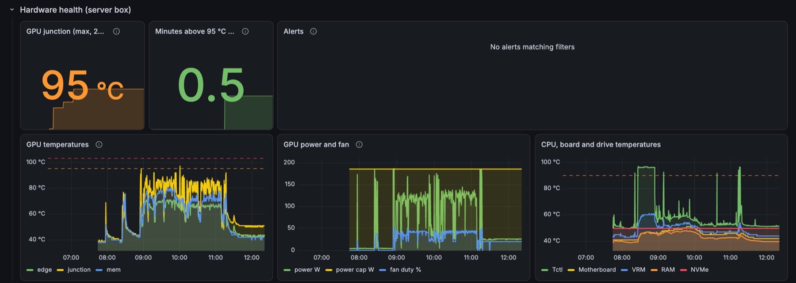
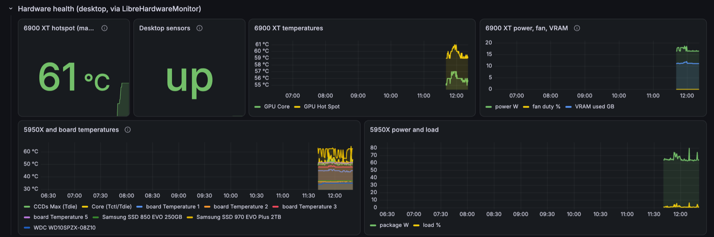

# Agent tools on the server box

### Monitoring, a CPU model, retrieval, web search and hardware health

RX 6700 XT box (Ubuntu, Ryzen 5 7600X) · served to agents over MCP · gemma4 12B as the answering model

October 2026 · reproducible with bench/rag.sh · results in docs/BENCHMARKS.md

---

## Key indicators

<b>82.5%</b>correct answers from retrieval: equal to handing the model the right file

<b>5×</b>fewer prompt tokens than the right file (2.0k vs 10.1k)

<b>8×</b>faster than pasting ~26k tokens of docs (8.5 s vs 69.8 s)

<b>87%</b>of answers' source passages in the top 5 (EmbeddingGemma + reranker)

<b>15×</b>faster reranking on the 6700 XT than the CPU (1 s vs 14 s)

<b>0 → 9/11</b>current-version questions right once gemma4 can search the web

<b>0.2 s</b>titles and classification on the CPU model (LFM2), no GPU slot used

<b>81 °C</b>6700 XT junction under load; 14 alert rules across both boxes, throttle at 110 °C

---

<!-- _paginate: true -->

---

---

## What runs on the server box

| service | where | listens on |
|---|---|---|
| gemma4 12B worker (4×32k) | GPU, systemd | Tailscale :8081 |
| EmbeddingGemma 300M · bge-reranker-v2-m3 | GPU, systemd (`install.sh aux`) | Tailscale :8083 / :8084 |
| LFM2 8B-A1B, quick jobs | CPU, container | Tailscale :8082 |
| `rdnamcp`: 7 agent tools over MCP | container, bearer token | Tailscale :8090 |
| Qdrant · SearXNG | containers | loopback only |
| Prometheus · node_exporter | containers | loopback only |
| Grafana · ntfy alerts | containers | Tailscale :3000 / :8095 |

The gateway serves `gemma4:12b` and `lfm2:8b` side by side and relays the desktop worker's metrics. **VRAM: 10.7 of 12.3 GB.**

---

## Monitoring: the inference pool

Grafana on the server box, last 6 hours (today's benchmark runs). Every worker behind the gateway, its tok/s, cache hits, slots and routing.

---

## Monitoring: agent tools

Calls and latency per MCP tool, tool errors (the one `fetch_url` error is a refused private address, by design), passages per collection, embed/rerank load and Qdrant latency.

---

## Quick jobs belong on a non-reasoning model

| CPU model (Ryzen 5 7600X) | decode | title · classify · pick an agent |
|---|---:|---:|
| **LFM2 8B-A1B** | 52 tok/s | **0.2–0.4 s**, all correct |
| LFM2.5 8B-A1B | 47 tok/s | ~6 s: always reasons ~280 tokens first; can't be turned off |

- 1B active parameters is fast enough on six Zen 4 cores, so short jobs never take a GPU slot.
- Not for research: with web tools it got only 4 of 11 version questions right, often inventing numbers.

---

## Retrieval quality: rerank, and the smallest embedder wins

150 questions over llama.cpp's docs (1,732 passages); only the exact source passage counts.
**A reranker adds 10–15 points. EmbeddingGemma 300M beat Qwen3-Embedding 0.6B by 25 points** before reranking.

---

## How many candidates to rerank

| EmbeddingGemma + bge-reranker | top 1 | top 5 | rerank time |
|---|---:|---:|---:|
| vector search only | 41% | 77% | 0 |
| rerank top 10 | 56% | 81% | ~0.6 s |
| **rerank top 20 (deployed)** | **58%** | **85%** | **~1.2 s** |
| rerank top 30 | 59% | 87% | 1.8 s |

A cross-encoder scores each passage on its own, so one pass over 30 gives all three depths. Times are on the 6700 XT beside gemma4; 10 and 20 are scaled from 30.

---

## Retrieval runs on the GPU

On the CPU a reranked search takes **14–20 s**; on the 6700 XT about **1–2 s**. Indexing is 15–17× faster. Both models fit beside the gemma4 worker with 1.5 GB to spare.

---

## Retrieval vs. pasting docs into the prompt

Same accuracy as the right file, **a fifth of the tokens, a third of the time**. Pasted docs scored 97% when they fit, but **9 of 40 overflowed the 32k slot**: these docs run about 2.4 characters per token.

---

## Web search: current facts

Live answers from go.dev, GitHub releases and endoflife.date. **gemma4 went from 0 to 9 of 11**, at 5.8 s per question; without tools it mostly declined. lfm2 searched, then still invented versions.

---

## Contention: what retrieval costs the worker

| background load (continuous) | gemma4 on the 6700 XT, 4 agents | lfm2 title job |
|---|---:|---:|
| none | 39.6 / 49.7 tok/s (two runs) | 0.23 s |
| CPU indexing | 46.5 / 46.3 tok/s | 0.28 s |
| **GPU reranking** | **24.9 tok/s** | 0.22 s |

- CPU work doesn't touch the GPU worker.
- Back-to-back reranking halves generation on the shared card. A real search is a ~1 s burst, so occasional searches are cheap; steady search traffic would want its own GPU (the RTX 3070 laptop is a candidate).

---

## Hardware health and alerts

| alert | threshold | card's own limit |
|---|---|---|
| GPU junction | warn > 95 °C for 10 min · critical > 103 °C for 2 min | throttles at 110 °C |
| GPU memory (GDDR6) | warn > 92 °C · critical > 100 °C | rated to 105 °C |
| GPU fan | 0 rpm while drawing > 60 W | – |
| CPU · VRM | > 90 °C · > 100 °C for 5 min | Ryzen 7000: 95 °C |
| availability | disk < 10% free · worker or exporter down 5 min | – |

Under the benchmark load: **81 °C junction, 72 °C memory, 123 W of a 186 W cap**. The desktop gets the same hotspot, fan and CPU alerts through LibreHardwareMonitor. 14 rules in all, pushed to a self-hosted ntfy topic.

---

## Hardware health on the dashboard

Top: 6700 XT through today's runs (95 °C peak, 30 s). Bottom: 6900 XT and 5950X via LibreHardwareMonitor.

---

---

## Deployed configuration

| piece | choice | why |
|---|---|---|
| embedder | EmbeddingGemma 300M, GPU | best recall, 5× faster indexing than Qwen3-Embedding |
| reranker | bge-reranker-v2-m3, GPU, top 20 | ties Qwen3-Reranker, 25% faster; 85% top-5 |
| chunks | 1,200 characters, 200 overlap | |
| quick-jobs model | LFM2 8B-A1B, CPU | 0.2–0.4 s, no GPU slot |
| research model | gemma4 12B + `web_search` / `fetch_url` | 9/11 on live facts |
| fetch safety | refuse private, tailnet and local addresses | no path from an agent to Prometheus, k3s or the LAN |
| memory | `remember` / `recall`, shared by all agents | |

---

## Next steps for this lab

1. **Wire into Hive:** add the MCP server (HTTP, `:8090/mcp`, bearer token). Hive has no "small jobs" model yet: titles use the chat's own runtime, so `lfm2:8b` needs a new Hive setting (a utility runtime for titles and summaries) before it can take that work.
2. **Phone alerts:** subscribe the ntfy app to the alert topic (over Tailscale).
3. **RTX 3070 laptop** as a worker for the reranker and quick-jobs model, taking that load off the 6700 XT.
4. **Smaller chunks** (around 600 characters): long chunks dilute a sentence's score; top-1 is 59%.
5. **gpt-oss 20B on the 6700 XT** for agent loops: fits fully, 100 tok/s, kept 100% of facts through compaction.

---

## Methodology and caveats

- Corpus: llama.cpp's Markdown docs at release b11723; questions written by gemma4 from random passages (seed 7).
- Strict metric: only the passage a question came from counts, though the docs repeat across backend guides.
- gemma4 graded the answers against the references; gemma4 wrote the questions, which may favour EmbeddingGemma slightly.
- Answering used fresh prompts (cache off), through the gateway, with both GPUs serving.
- Web truth fetched live at run time; the 11 questions change answers as releases happen.
- Contention loads were continuous worst cases; idle throughput varied between runs (39.6 vs 49.7 tok/s).

bench/rag.sh · cmd/ragbench · cmd/rdnamcp · deploy/sff · docs/BENCHMARKS.md

---

<!-- _class: tight -->

## Main takeaways

1. **Retrieve, don't paste.** With 32k slots, the top 5 reranked passages answered as well as the right file, at a fifth of the tokens and 8× faster than pasted docs, which often overflow the slot.
2. **Run retrieval on the GPU, beside the chat model.** Embedder + reranker take ~1.5 GB of VRAM; on the CPU a reranked search costs 14–20 s. Rerank the top 20.
3. **Pick a small embedder, always rerank.** EmbeddingGemma 300M beat Qwen3-Embedding 0.6B by 25 points at 5× the indexing speed; a reranker adds 10–15.
4. **CPU for quick jobs, with a non-reasoning model.** LFM2 8B-A1B: titles and classification in 0.2–0.4 s on six cores. Reasoning models take 6 s; small models shouldn't do research.
5. **Give local models web tools.** gemma4 12B: 0 → 9 of 11 current facts. Block fetches to private and local addresses.
6. **Size for contention.** Back-to-back reranking halves generation on a shared card; bursty search is cheap, heavy search wants its own GPU.
7. **Alert on heat below the limits.** RDNA2 hotspots reach ~95 °C in sustained bursts; alert at 95 / 103 °C, under the 110 °C throttle.
