# RDNA2 as a first-class local inference target

### rdna-gateway: benchmarks, findings, recommendations

RX 6900 XT (Windows) · RX 6700 XT (Ubuntu) · M4 MacBook Air
llama.cpp ROCm gfx103X · cache-aware OpenAI-compatible gateway

October 2026 · every number is reproducible with bench/lab.sh

---

## Key indicators

<b>5.8×</b>prefill vs Ollama on the same card (ROCm + flash-attn)

<b>2×</b>decode from the upstream GGUF vs Ollama's copy of the same model

<b>2.7×</b>faster agent sessions with prefix caching (37 s vs 100 s)

<b>−42%</b>wall time from a 32 GB host-RAM prompt cache under slot pressure

<b>2.1×</b>least-loaded vs round-robin on long contexts, two cards

<b>119</b>tok/s decode, gpt-oss 20B MoE on the 6900 XT (2.2× gemma4 12B)

<b>37</b>tok/s, Qwen3.6 35B MoE on a 16 GB card via expert offload

<b>83</b>tok/s aggregate, 8 agents on the deployed two-card pool, 0 failures

---

## The lab

| | RX 6900 XT | RX 6700 XT | MacBook Air |
|---|---|---|---|
| GPU | gfx1030 · 16 GB · 512 GB/s | gfx1031 · 12 GB · 384 GB/s | M4 · 24 GB unified · 120 GB/s |
| Host | Win 11 · 5950X · 64 GB | Ubuntu 24.04 · Ryzen 7000 · 62 GB | macOS, fanless |
| Runtime | llama.cpp ROCm gfx103X (+ Vulkan for A/B) | llama.cpp ROCm gfx103X | llama.cpp Metal |

**Models:** gemma4 12B Q4_0 (dense) · LFM2.5 8B-A1B · gpt-oss 20B MXFP4 · Qwen3.6 35B-A3B Q4_K_M

**Workload:** agent loops with a long system prompt, tool results each turn, and fixed 128-token replies.
vLLM and SGLang don't support gfx1030, so llama.cpp + a router *is* the RDNA2 serving stack.

---

<!-- _paginate: true -->

---

---

## Backend: ROCm, never Vulkan, for long prompts

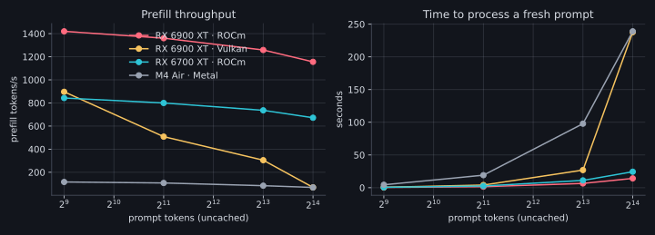

Vulkan prefill collapses to 69 tok/s at 16k tokens: a fresh 16k prompt takes 238 s, versus 14 s on ROCm.

---

## Flash attention: on for ROCm

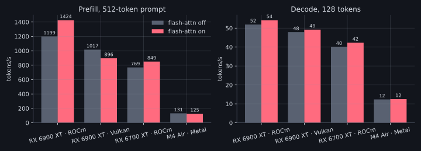

**+19% prefill** on ROCm. It *hurts* on Vulkan. The M4 Air is shown for scale.

---

## KV-cache type is free on ROCm

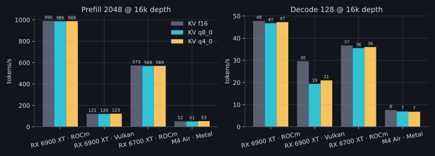

f16, q8_0 and q4_0 run at **identical speed** at 16k depth, so compress the KV and spend the VRAM on slots and context.

---

## Decode holds up deep into context

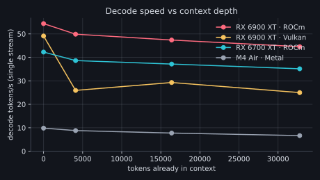

The 6900 XT goes from 54 to 45 tok/s at 32k tokens of history, and the 6700 XT from 42 to 35. Vulkan halves after 4k.

---

## Slots: 4 × 32k is the layout

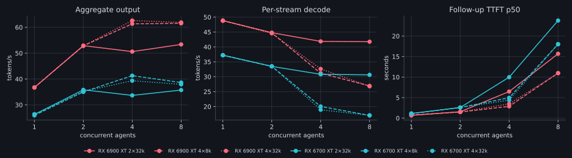

4 slots raise aggregate throughput (62 vs 53 tok/s) at the cost of per-stream speed. Under 10 GB of VRAM on both cards.

---

## Memory per configuration

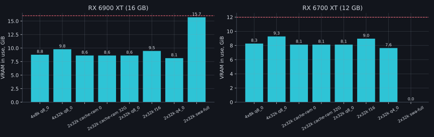

The sliding-window cache keeps 4×32k cheap. `--swa-full` doesn't fit 2×32k on 12 GB. Host RSS grows with the RAM prompt cache.

---

## Caching: fresh vs cached prompts

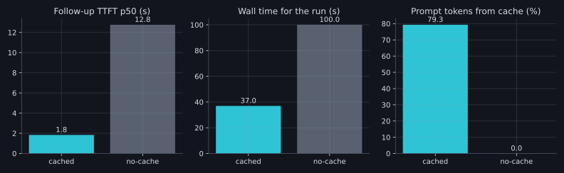

2 agents × 6 turns at about 7k tokens: **37 s cached vs 100 s fresh** (2.7×).

---

## Time to first token as context grows

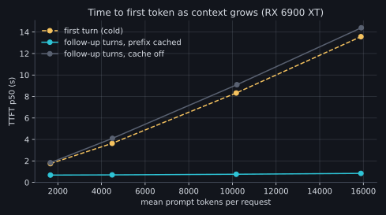

A follow-up turn at 16k tokens starts in **0.8 s cached** versus **14 s fresh**.

---

## Host-RAM cache, SWA and unified KV

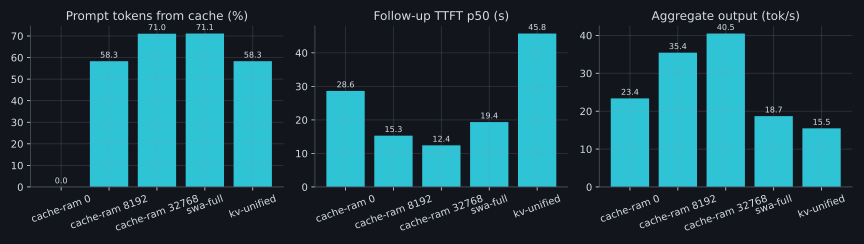

6 agents on 2 slots: evicted conversations restore from RAM. **Off 131 s → 8 GB 87 s → 32 GB 76 s.**
`--swa-full` (1.9×) and `--kv-unified` (2.3×) made it **slower**: keep the defaults.

---

## Compaction: where you put the summary matters

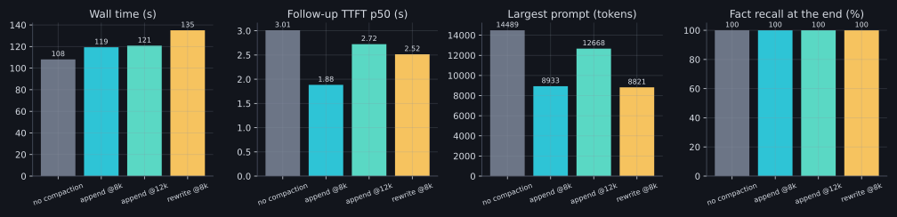

- **Summary after the system prompt:** the next turn is 75% cached and starts in 1.8 s. **Summary inside it:** 0% cached, 5.6 s.
- Each summary costs 20–34 s, so compact late. At about 16k tokens, never compacting was fastest.
- Recall survived compaction for gemma4, gpt-oss and Qwen3.6 (100%). LFM2.5 (1B active) kept half.

---

## Routing across two cards

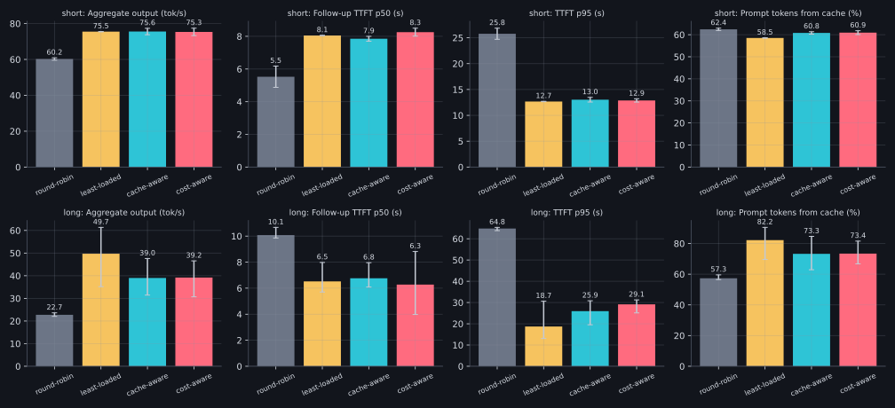

Round-robin loses 25–50%. On long contexts **least-loaded beats prefix affinity**: affinity overfills a warm card's slots and forces evictions.

---

## Dense vs small MoE

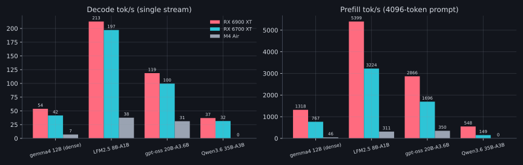

gpt-oss 20B: **2,866 / 119 tok/s** (prefill / decode) on the 6900 XT, 2.2× gemma4 12B. The Mac was thermally throttled by this point.

---

## MoE bigger than VRAM: expert offload

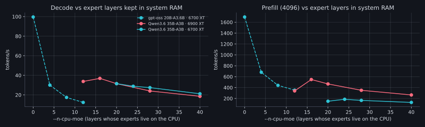

`--n-cpu-moe` keeps the experts of N layers in system RAM. Qwen3.6 35B peaks at **N = 16 → 37 tok/s** on 16 GB; fewer overflows VRAM.

---

## Quality: needle in a haystack

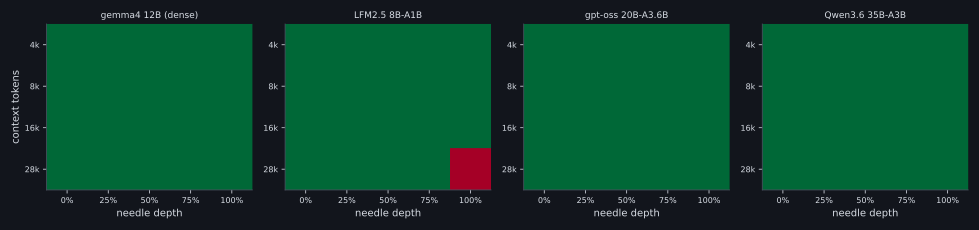

One planted fact, 4k–28k tokens, 5 depths, cache off. gemma4, gpt-oss and Qwen3.6: **20/20**; LFM2.5: 19/20.
Reasoning models need an answer budget: at 160 tokens gpt-oss and LFM2.5 "failed" by running out mid-thought.

---

## Quality: agent memory across compaction

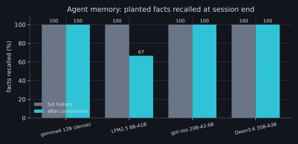

Facts planted in tool results, quizzed at session end: gemma4, gpt-oss and Qwen3.6 **100%** after compaction; LFM2.5 **67%**: the smallest model's summaries drop facts.

---

## The MacBook: fallback, not a worker

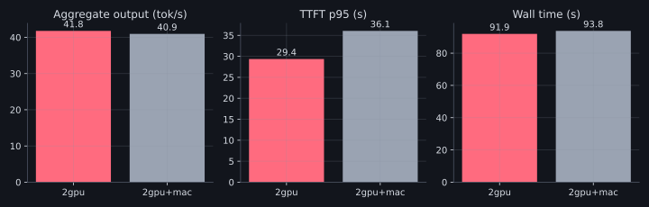

- 11× slower prefill, 4–8× slower decode, and it throttles (12.5 → 7 tok/s under sustained load).
- As a pool member the cost-aware router gave it **0 of 30** requests.
- As `fallback: true` it served everything, without errors, while both GPU boxes were down.

---

## Recommended deployment (live: 8 agents → 83 tok/s)

| setting | value | why |
|---|---|---|
| runtime | llama.cpp ROCm gfx103X, `-fa on` | 5.8× Ollama's prefill |
| model file | upstream GGUF | 2× Ollama-blob decode |
| slots | `--parallel 4 -c 131072` (4×32k) | best aggregate, under 10 GB |
| KV | `-ctk q8_0 -ctv q8_0` | free on ROCm |
| prompt cache | `--cache-ram 32768`, `--cache-reuse 256` | −42% under slot pressure |
| leave off | `--swa-full`, `--kv-unified` | 1.9× / 2.3× slower |
| routing | `least-loaded`, 6700 XT `weight` 0.65 | best on long contexts |
| Mac | `fallback: true` | availability, not speed |

---

## Improving utilization (no new hardware)

1. **Pick the model per job:** gpt-oss 20B for fast agent loops (2.2× gemma4, and it keeps facts through compaction); Qwen3.6 35B when quality matters; LFM2.5 only for short, uncompacted tasks.
2. **Specialize the cards:** gpt-oss fits the 6700 XT entirely (100 tok/s, faster than gemma4 on the 6900 XT), and the gateway already routes by model.
3. **Router v2:** count resident sessions per slot, not just in-flight requests, so affinity stops before a warm card overflows.
4. **Compaction policy in Hive:** summary after a stable system prompt, triggered near the slot limit.
5. **Speculative decoding:** an EAGLE-3 draft for gpt-oss exists (0.9 GB). Next experiment.
6. **Keep the 6900 XT's VRAM clear:** the desktop compositor already holds 2.5 GB, and a game would evict the model.

---

## Upgrades: what extra hardware would buy

Decode is memory-bandwidth-bound and MoE offload is VRAM-bound. *Estimates are from bandwidth ratios, not measured.*

| option | effect | stays on RDNA2? |
|---|---|---|
| **Radeon Pro W6800 32 GB** (gfx1030) | Qwen3.6 35B entirely in VRAM: est. 2–3× its offloaded 37 tok/s; two models resident | ✅ same stack |
| **2nd 16 GB RDNA2 card** in the desktop | a third worker: est. +50–60 tok/s aggregate; or layer split for 32 GB models | ✅ |
| **RX 7900 XTX 24 GB** (RDNA3, 960 GB/s) | est. 1.8× decode; also unlocks vLLM / SGLang (gfx1100) | ❌ new gen |
| faster system RAM | helps only MoE expert offload | – |
| **skip:** Mac as a worker, faster LAN, more CPU cores | not the bottleneck | – |

---

## Methodology

- `bench/micro.sh`: llama-bench suites (FA, prefill length, decode depth, KV type, ubatch, MoE offload sweeps).
- `bench/lab.sh`: reconfigures workers over SSH, verifies the served model, and runs serving, cache, compaction, routing, memory and quality matrices.
- `rdnabench`: agent traffic, `-no-cache`, `-compact-at`, `-facts` recall, `-needle`.
- Long routing runs were repeated 4×; the error bars show the min/max spread.
- Caveat: the 6900 XT is someone's everyday desktop, so background load adds variance.

github.com/zazulam/rdna-gateway · docs/BENCHMARKS.md · bench/results/tables.md
